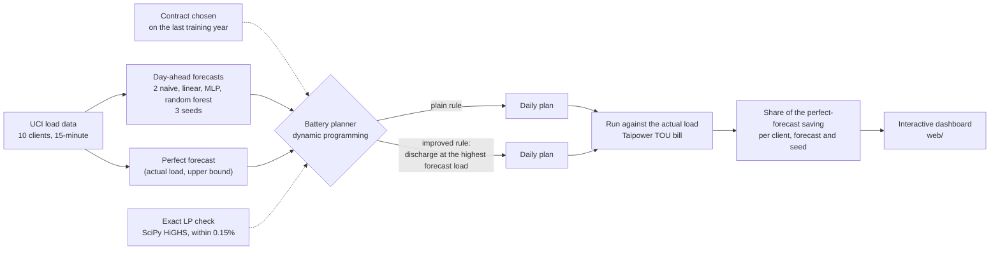

# Day-Ahead Load Forecasting for Battery Scheduling

A battery cuts an electricity bill only as well as the plan made for it the evening before, and that plan relies on a forecast of tomorrow's load. This project measures how much forecast quality is actually worth: day-ahead forecasts from five methods drive a battery planner on 10 real clients, and every plan is billed with the Taipower high-voltage time-of-use tariff.

Result in one line: across 10 clients, changing one planning rule moved the saving by 10.5 points on average, while choosing between five forecasts moved it by a median of 3.7 points.

**Results site:** https://chenyi494.github.io/load-forecasting-battery-scheduling/ (built from `web/` by GitHub Actions on every push to `master`). Run it locally with `cd web && npm install && npm run dev`: an interactive experiment dashboard (pick a client, forecast and planning rule), a replay of single days with the battery, all result tables, and the original accuracy-vs-compute benchmark as an appendix. Every number on it is computed from files in `results/` and `predictions/`.

## Pipeline



Each test day the plan is made from the forecast before the day starts, then billed against what actually happened. The two planning rules split at the planner; that split is where the main finding comes from.

## Findings

Score: the share of the saving a perfect forecast would get, over 288 test days (Mar–Dec 2014). "Plain plan" is a cost-minimizing battery schedule; "improved plan" adds one rule (below). Mean of five forecasts; MLP and random forest averaged over 3 seeds.

| Client | Mean load (kW) | Perfect-forecast saving | Plain plan | Improved plan | Gain (pts) |
| --- | ---: | ---: | ---: | ---: | ---: |
| MT_200 | 864 | 4.1% | 79.5–86.3% | 86.8–91.0% | +7.0 |
| MT_068 | 164 | 6.7% | 44.1–47.5% | 75.8–79.3% | +31.6 |
| MT_069 | 163 | 4.9% | 72.7–79.4% | 83.5–94.4% | +14.1 |
| MT_139 | 399 | 3.6% | 86.0–88.7% | 91.4–94.3% | +5.9 |
| MT_216 | 2,219 | 3.5% | 87.1–89.7% | 90.5–92.5% | +3.1 |
| MT_217 | 216 | 4.7% | 71.1–73.8% | 75.9–79.9% | +6.5 |
| MT_271 | 155 | 3.3% | 85.8–86.7% | 89.1–90.4% | +3.6 |
| MT_287 | 161 | 4.1% | 78.8–83.7% | 84.1–87.0% | +5.0 |
| MT_302 | 130 | 4.7% | 49.5–50.9% | 58.7–68.2% | +14.9 |
| MT_329 | 218 | 4.6% | 60.1–67.4% | 74.3–80.2% | +13.5 |

1. **The planning rule matters more than the model.** Inside one price period every hour costs the same, so a plain optimizer has no reason to prefer one hour over another; when the forecast stays under the contract it may spend the battery early and have nothing left for the real peak. A tiny cost on high grid draw makes it discharge where the forecast load is highest. This raises every forecast's share on all 10 clients, by 10.5 points on average (3.1–31.6).
2. **A weak plan hides forecast quality.** With the plain plan the gap between the best and worst forecast is larger than the spread across seeds of one model on only 5 of 10 clients, and the RMSE ranking barely matches the bill ranking (median Spearman 0.35). With the improved plan the gap exceeds the seed spread on 10 of 10 clients and the correlation rises to 0.65.
3. **Better forecasts then help, but by a few points.** Mean share with the improved plan: linear regression 85.1%, MLP 85.5%, random forest 84.5%, against 82.1% for same-time-yesterday and 82.2% for same-time-last-week. Median gap between best and worst: 3.7 points.
4. **The error of the daily maximum does not rank the bills** (median Spearman 0.15 plain, -0.30 improved). On MT_200 the learned models under-forecast the daily peak most often, but that does not generalize.
5. **One client is not enough to rank models.** MT_200 rerun through the multi-client pipeline (contract on a finer grid; that ETL keeps 21 intervals the main ETL drops) moves the MLP's plain-plan share by about 5 points.

This quantifies a known idea (value-oriented forecasting): accuracy metrics such as RMSE do not rank forecasts by the value of the decisions made with them.

### What did not work

Planning with forecast + a safety margin (a quantile of each forecast's own errors on the 90 days before the test period). On MT_200 the margin cuts the excess-demand charge but keeps the battery from buying cheap and selling dear, and the two nearly cancel: with the MLP the share moves from 81.4% to at most 82.5%.

## The setup

| Item | Setting |
| --- | --- |
| Data | [UCI ElectricityLoadDiagrams20112014](https://archive.ics.uci.edu/dataset/321/electricityloaddiagrams20112014), 15-minute load (kW) of Portuguese clients |
| Clients | MT_200 plus 9 drawn at random (seed 42) from the 200 of 370 clients with data on ≥99% of days in 2012–2014 and mean load ≥100 kW |
| Forecast | all 96 intervals of tomorrow from data up to 23:45 today (tests check no feature reads the forecast day); training before 15 Mar 2014 |
| Methods | same time yesterday, same time last week, linear regression, MLP (128×64), random forest (100 trees, depth 10); 3 seeds for MLP and random forest |
| Battery | 2 hours of the client's mean load, power 0.5 × mean load, 90% round trip (an assumption) |
| Contract | chosen once from the last 12 months of training data, before the test period |
| Planner | dynamic programming over the state of charge, one day at a time; agrees with an exact linear program (SciPy HiGHS) to within 0.15% on real test days |
| Bill | Taipower high-voltage two-stage TOU (tariff tables effective 2025-10-01, `configs/tariff.yaml`): energy, contracted capacity, excess demand at 2× (first 10%) and 3× |
| Test | 15 Mar – 31 Dec 2014, complete days only |

The detailed MT_200 backtest also covers 1 h and 4 h batteries, tariff periods shifted by ±2 h, the cost breakdown and the monthly excess charge (see the site's "All results" page).

## Limitations

- The tariff is Taiwanese and the loads are Portuguese: an illustrative price structure, not a real bill. Results depend on it; heavy excess-demand charges are what make forecast errors costly here. Taiwanese public holidays are not applied.
- The battery size and efficiency are assumptions; the planner works one day at a time and does not know the month's highest demand so far.
- Ten clients and one test year; the full sensitivity analysis is on MT_200 only.
- Timings in the appendix come from one laptop.

## Run it

Python 3.12 and Node 22.

```bash
python3.12 -m venv .venv && source .venv/bin/activate
pip install -r requirements.txt
python -m benchmark.data.download        # UCI data into data/raw/, SHA-256 checked
python -m benchmark.data.prepare         # MT_200 features -> data/source_data.parquet

# Day-ahead forecasts and battery decisions (MT_200)
python -m benchmark.dayahead.train       # forecasts, 3 seeds -> predictions/, results/dayahead_results.csv
python -m benchmark.dayahead.calibrate   # errors on the 90 days before the test period (for the margin)
python -m benchmark.decision.backtest    # contract, battery sizes, tariff shifts -> results/decision_*.csv (about 17 min)
python -m benchmark.decision.margin      # forecast + safety margin
python -m benchmark.decision.flatten     # improved plan

# Ten clients
python -m benchmark.multiclient.select   # selection rule -> data/clients.parquet, results/multiclient/selection.json
python -m benchmark.multiclient.run      # each client in its own process (about 20 min with 4 workers)
python -m benchmark.multiclient.summary  # -> results/multiclient/summary.csv

# Appendix: accuracy vs compute
python -m benchmark.experiments.grids    # experiment grids -> benchmark/experiments/configs/
python -m benchmark.run                  # 204 runs -> results/summary_results.csv (resumable)

python -m benchmark.export               # -> web/public/results.json
python -m benchmark.decision.export      # -> web/public/decision.json
python -m pytest -q tests                # leakage, DP vs LP, tariff and planner tests
cd web && npm install && npm run dev
```

`data/source_data.parquet` is committed, so the MT_200 steps can run without the download; `data/clients.parquet` is not and needs the download.

## Repository

```
benchmark/
├── dayahead/               day-ahead features, training, calibration
├── decision/               tariff, battery, DP planner, LP check, backtest, margin, improved plan, export
├── multiclient/            client selection, per-client runs, summary
├── data/ models/ training/ experiments/   appendix benchmark: ETL, models, timing and memory, grids
├── run.py · export.py · check_splits.py · hardware.py · time_tools.py
configs/                    tariff.yaml (Taipower), battery.yaml
tests/                      pytest: leakage, DP vs LP, tariff, planner
predictions/                day-ahead forecasts and battery schedules (parquet)
results/                    decision_*.csv, dayahead_results.csv, multiclient/, summary_results.csv (appendix), before/ (March 2026)
web/                        results site (React, TypeScript, ECharts)
```

## Appendix: next-15-minute forecasting, accuracy vs. compute

The study this project started from: how much do linear regression, an MLP and a random forest improve on repeating the last value when forecasting the next 15 minutes of MT_200's load, and what do they cost to train and run?

### Results

Median over configurations and seeds, on one fixed test period (14 Mar 2014 – 1 Jan 2015, 28,025 intervals). RMSE and MAE in kW; memory is the increase in process RSS during training.

| Model | Training rows | RMSE | MAE | Train time (s) | Memory (MB) | Latency per row (ms) |
| --- | ---: | ---: | ---: | ---: | ---: | ---: |
| Persistence (value 15 min earlier) | — | 42.3 | 29.4 | — | — | 0.001 |
| Same time yesterday | — | 70.2 | 47.2 | — | — | 0.001 |
| Linear regression | 1,000 | 41.9 | 29.9 | 0.003 | 0.1 | 0.033 |
| | 10,000 | 39.4 | 27.8 | 0.003 | 0.1 | 0.033 |
| | 100,000 | 38.4 | 27.5 | 0.005 | 4.7 | 0.033 |
| MLP | 1,000 | 51.5 | 37.2 | 0.152 | 11.6 | 0.042 |
| | 10,000 | 45.9 | 33.9 | 1.374 | 12.8 | 0.043 |
| | 100,000 | 36.1 | 26.9 | 9.483 | 30.0 | 0.042 |
| Random forest | 1,000 | 84.9 | 54.6 | 0.097 | 4.9 | 2.142 |
| | 10,000 | 82.4 | 50.7 | 0.765 | 55.9 | 2.119 |
| | 100,000 | 39.3 | 28.7 | 8.051 | 212.0 | 2.222 |

Findings:

1. **The best model beats persistence by 19%.** An MLP (128×64, 100,000 training rows) reaches 34.1 kW RMSE against 42.3 kW for repeating the last value. With 1,000 rows, linear regression is barely better than persistence.
2. **Random forests fail outside their training range.** With 1,000 or 10,000 rows, training covers only winter. 12.5% of test loads (summer) exceed the highest training load; a forest cannot predict above it, so its error there is 208 kW against 41 kW elsewhere. Linear regression and the MLP extrapolate through the lag features.
3. **Accuracy costs memory.** At 100,000 rows the random forest needs about 212 MB to train and is 85 MB on disk; linear regression needs under 5 MB.

### Data and task

- [UCI ElectricityLoadDiagrams20112014](https://archive.ics.uci.edu/dataset/321/electricityloaddiagrams20112014): 15-minute load in kW for 370 Portuguese clients, 2011–2014 (CC BY 4.0). This project uses client `MT_200`, 140,123 valid rows.
- Target: load in the next 15-minute interval.
- Features: hour, minute, day of week, weekend flag, `lag_1` (15 minutes earlier), `lag_96` (24 hours earlier).
- This is a retrospective comparison of methods on historical data, not a forecast of current demand.

### Method

| Item | Setting |
| --- | --- |
| Test period | Last 20% of the data, identical for every run |
| Training data | 1,000 / 10,000 / 100,000 rows immediately before the test period; last 10% used for MLP early stopping |
| Scaling | Features standardized with training statistics only; MLP target standardized too |
| Linear regression | OLS and Ridge (α = 0.01, 1, 10) |
| MLP | 64×32, 128×64, 256×128×64; dropout 0 / 0.3; batch 32 / 256; Adam, early stopping (patience 5) |
| Random forest | 50 / 100 trees; depth 10 / 50 / unlimited; all features at each split |
| Seeds | 42, 123, 999 (baselines once per size) — 204 runs in total |
| Latency | 200 test rows predicted one at a time, 5 rounds after a warm-up; median and p95 |
| Memory | Process RSS sampled every 10 ms during training; each run in a fresh process |
| Threads | Single-threaded (PyTorch, BLAS, scikit-learn) |
| Machine | Apple M2 Pro, 16 GB, macOS 15.6, Python 3.12 |

### Revisions

The benchmark was first built in **March 2026**. A review in **November 2026** found errors in the evaluation; every run was repeated after fixing them. The March results are kept in `results/before/` for comparison.

| Problem in March | Fix |
| --- | --- |
| Each training size was tested on a different period | One fixed test period |
| MLP early stopping kept a reference to the weights, not a copy, and did not restore the best weights | Deep copy, always restored |
| Lag features were built after removing zero readings, misaligning `lag_96` near gaps | Lags computed on the full timeline |
| Unscaled MLP target, unshuffled batches, no PyTorch seed | Fixed |
| Latency was one `time.time()` call around the whole test set | Per-row `perf_counter` timing |
| Memory from `tracemalloc` in one shared process | RSS sampling, one process per run |
| No naive baseline; custom "efficiency score" | Persistence and same-time-yesterday baselines; score removed |
| Streamlit dashboard with hard-coded verdicts and MW units | Replaced by the static results site; kW |

Conclusions that changed: the MLP's March error at 1,000 rows (118 kW) was a bug, and the small random forest went from best to worst once it had to forecast a later season. March numbers came from different test periods, so they are not a like-for-like comparison.
